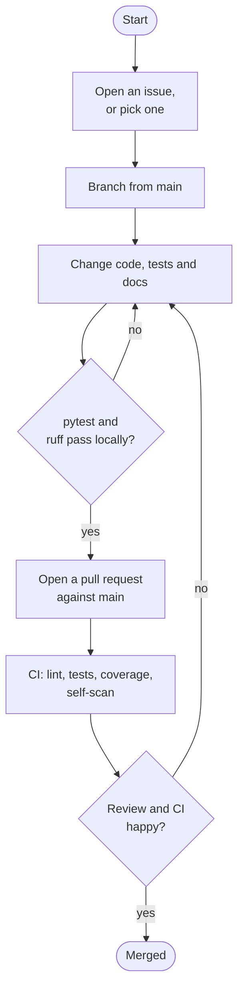

# Contributing to DecaScan

Thank you for helping. Bug reports, a missing rule, a false positive you can show us, a clearer sentence
in the docs: all of it is welcome, and none of it needs to be big.

## Contents

- [Code of conduct](#code-of-conduct)
- [How to contribute](#how-to-contribute)
- [Development setup](#development-setup)
- [Code style](#code-style)
- [Testing](#testing)
- [Adding a rule](#adding-a-rule)
- [Documentation](#documentation)
- [Project structure](#project-structure)
- [Workflow and commits](#workflow-and-commits)
- [Security issues](#security-issues)
- [Releases](#releases)
- [License](#license)

## Code of conduct

Be respectful and constructive, assume good faith, and keep the discussion about the code. Harassment of
any kind is not accepted. A maintainer may edit or remove a comment, or block someone, to keep the project
a place people want to work in.

## How to contribute



### Reporting a bug

Check the existing issues first. A good report contains:

1. what you ran, exactly (`decascan scan ... `), and what you expected;
2. what happened instead: the output, or the error;
3. your environment: `decascan --version`, your Python version and your OS;
4. the smallest file that shows it. For a false positive or a miss, the few lines of source are the most
   useful thing you can send;
5. the log, when it helps: `decascan -vv scan <path>` writes what the tool decided, and why, to stderr.

Please remove secrets from anything you paste. DecaScan redacts the credentials it finds, but your own
files may hold others.

### Suggesting a feature

Say what you are trying to do, not only what you want added, and why the current behaviour does not get
you there. A proposal for a new rule should name the risk (the Top 10 category), show code that should be
reported, and show similar code that should not.

### Your first contribution

Look for issues labelled `good first issue` or `help wanted`. Fixing a false positive is a good way in:
find the rule, add the shape that was wrongly reported as a quiet test, and make the test pass.

## Development setup

You need Python 3.10 or newer. [uv](https://docs.astral.sh/uv/) is the quickest way to set up, but plain
`venv` and `pip` work.

```bash
git clone https://github.com/cvas22/decascan
cd decascan

uv venv --python 3.12
uv pip install -e ".[dev]"            # or: python -m venv .venv && .venv/bin/pip install -e ".[dev]"

decascan --version                    # the command is installed into the virtualenv
pytest                                # the unit tests
ruff check .                          # lint
```

If you cloned a fork, add the original repository as `upstream` so you can keep up to date:
`git remote add upstream https://github.com/cvas22/decascan`.

## Code style

- **ruff** does the linting, with the rules in `pyproject.toml` (line length 110; `E`, `F`, `I`, `UP`, `B`).
  Run `ruff check .` before you push, and `ruff check . --fix` to apply the safe fixes. There is no separate
  formatter, import sorter or type checker to run.
- Match the code around you: the same comment density, naming and idiom. Comments explain why, not what.
- Python 3.10 is the floor, so no `tomllib`, no `match` on 3.10-incompatible syntax, nothing newer than the
  oldest supported version.
- The scanner is **offline and never runs the code it scans**. Do not add network calls, and do not import
  or execute anything from a scanned directory.
- A change to what the tool reports should keep false positives low. A rule that fires on honest code gets
  turned off.

### Tools and attribution

Commits, pull requests, code comments and documentation describe the change in plain technical terms.
Do not include tool or assistant branding, and do not add automatically generated co-author trailers.

## Testing

```bash
pytest                              # everything
pytest tests/test_rules.py -q       # one file
pytest tests/test_mask.py::test_multiline_docstring_is_masked_but_the_code_after_it_is_not
pytest --cov=decascan               # with coverage; CI fails under the floor set in pyproject.toml
```

- Test behaviour, not implementation. Every rule needs a case that fires **and** a nearby safe case that
  does not.
- Tests build their inputs in `tmp_path` or use the fixtures under `tests/fixtures/`. The `clean_*`
  fixtures must produce no findings; if a change makes one light up, that is a false positive.
- Some symlink tests are skipped where creating a symlink needs a privilege (Windows without developer
  mode). They run in CI on Linux and macOS.
- CI also scans the vulnerable and clean fixtures with the real command, and runs DecaScan on its own
  source (`self-scan`).

## Adding a rule

1. Write the rule with `@rule(id=..., mcp_id=<risk id>, name=..., description=...)` in the module for its
   list: `rules/mcp0N_*.py` for the MCP list, `rules/llm_top10.py` or `rules/web_top10.py` for the others.
   The risk id must exist in `core/standards.py`.
2. Add samples: for an LLM or web rule, a firing and a quiet sample in `tests/test_web_llm_rules.py`; for
   an MCP rule, cases in `tests/test_rules.py` (or `tests/test_mcp_rules_negative.py`).
3. Refresh what is generated from the rules (below).
4. Add a line to the Unreleased section of `CHANGELOG.md`.

To add a whole new Top 10 list, define a `Standard` in `core/standards.py`, add it to `STANDARDS`, and write
its rule module. Risk ids must be unique across lists.

## Documentation

The prose in `README.md` and `docs/` is written by hand. Three things are generated and should be refreshed
when the code they come from changes:

```bash
python scripts/generate_rule_docs.py          # the LLM and web sections of docs/rules.md
decascan standards --export src/decascan/data/top10   # the cached Top 10 catalog, one file per list
python scripts/generate_assets.py             # the README's terminal screenshot and coverage chart
```

Write MCP rule sections in `docs/rules.md` by hand under `### <RULE-ID>`. Keep the README true to what the
tool does: if you change a default, an option or an exit code, change the README in the same pull request.

## Project structure

```
src/decascan/
  cli.py                 the command line: scan, rules, standards
  catalog.py             the cached Top 10 catalog
  core/                  scanning: config, context, scanner, findings, detection, merging, paths, logging
  parsers/               Python, TypeScript/JavaScript, manifests and dependency files into shared facts
  rules/                 one module per MCP risk, plus llm_top10.py and web_top10.py
  outputs/               pretty, JSON, SARIF and GitHub annotation output
  data/top10/            the cached catalog: one JSON file per Top 10 list
tests/                   unit tests, and fixtures/ with small vulnerable and clean example projects
docs/                    rules.md, standards.md, ci.md and the README's pictures (assets/)
scripts/                 generate_rule_docs.py, generate_assets.py
action.yml               the GitHub Action other repositories can use
.github/                 workflows, Dependabot, code owners, labeler
```

A rule is a function from a `ScanContext` to findings. Parsers turn each language into the shared facts in
`parsers/common.py`, so rules do not care whether a server is Python or TypeScript.

## Workflow and commits

1. Fork the repository (or, if you have write access, branch from `main`).
2. Create a branch: `feat/short-name`, `fix/short-name`, `docs/short-name`.
3. Make small, focused commits. Keep unrelated changes in separate pull requests.
4. Keep up to date: `git fetch upstream && git rebase upstream/main`.
5. Push, and open a pull request **against `main`**.

If a change depends on another open pull request, say so in the description and merge them in order. Do
not merge a pull request into another pull request's branch: that leaves its changes off `main`.

CI must pass: lint, the unit tests with the coverage floor, the fixture scans, the self-scan and the wheel
check. Pull requests are labelled automatically from the paths they change, and the code owners in
`.github/CODEOWNERS` are asked to review.

### Commit messages

We use [Conventional Commits](https://www.conventionalcommits.org/):

```
type(scope): short description in the imperative

Optional body: what changed and why, wrapped at about 100 columns.
```

Types: `feat`, `fix`, `docs`, `test`, `refactor`, `build`, `ci`, `chore`.

```
feat: add a log event for slow rules
fix: do not report a call that appears only inside a docstring
docs: describe the exit codes
test: cover the dependency parser's URL fragments
ci: pin the actions to commit SHAs
```

## Security issues

If you find a vulnerability in DecaScan itself, for example a crafted file that makes the scanner read
outside the directory it was pointed at, or run code, please do not open a public issue. Report it
privately using GitHub's *Report a vulnerability* option on the repository's Security tab, and include
a way to reproduce it. Findings about the code *DecaScan scans* are ordinary issues.

## Releases

Maintainers only. Update the version in `pyproject.toml` and move the Unreleased notes in `CHANGELOG.md`
under it, merge that to `main`, then publish a GitHub Release tagged `vX.Y.Z`. The release workflow runs the
full CI suite and, if it passes, builds the package and publishes it to PyPI with Trusted Publishing: there
is no API token to manage.

## License

DecaScan is licensed under Apache-2.0. By contributing you agree that your contribution is licensed
under the same terms.

## Questions

Open an issue with the `question` label, or ask on the pull request. Contributors appear on the repository's
contributors page, and significant contributions are credited in the release notes.
