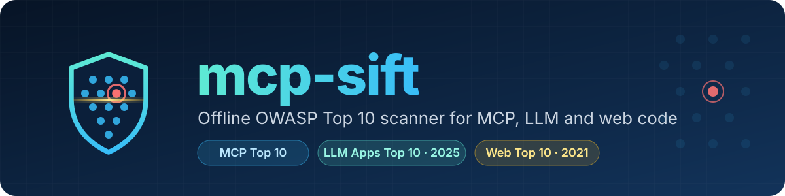
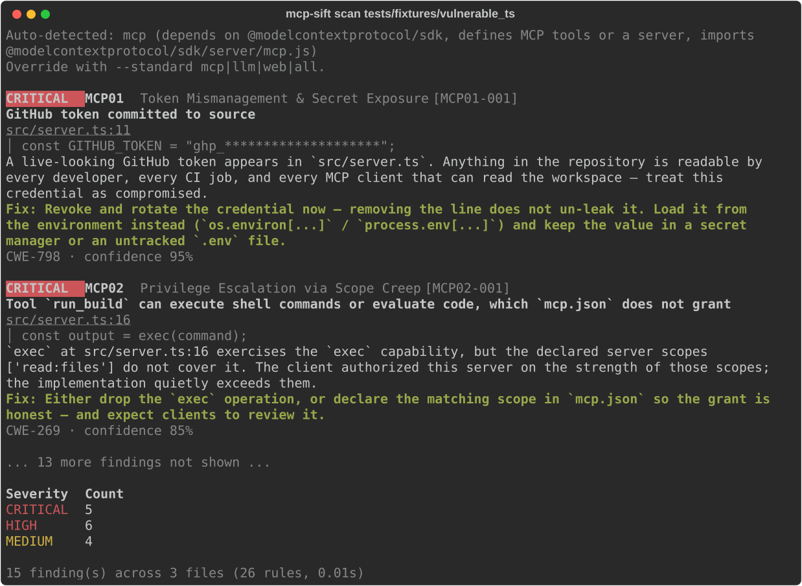
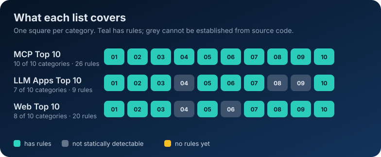
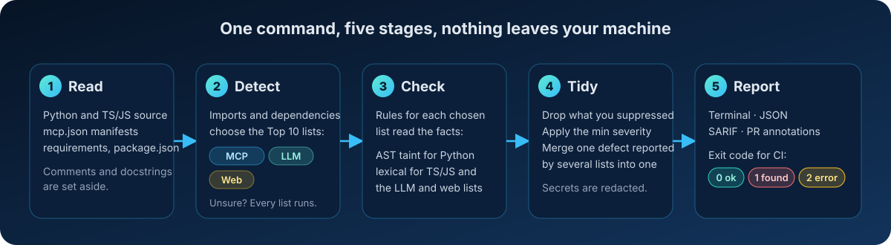

<div align="center">



[](#install)
[](LICENSE)
[](#how-it-works-and-where-it-stops)
[](#what-it-checks)
[](#status)

**A security scanner for Python and TypeScript code, mapped to three OWASP Top 10 lists:
the MCP Top 10, the Top 10 for LLM Applications, and the web Top 10.**

[Install](#install) · [Use](#use) · [CI/CD](#cicd) · [Rules](docs/rules.md) · [Changelog](CHANGELOG.md)

</div>

---
Created and led by **Srinivas Chippagiri** ([@cvas22](https://github.com/cvas22)): DecaScan, a scanner for the OWASP MCP, LLM Applications and web Top 10 lists.

⭐ If DecaScan helps you check your code against the OWASP Top 10, **star the repo.** Stars are how other teams find it.

**DecaScan** takes its name from *deca*, ten: it scans for the OWASP Top 10 risks. The command is
`decascan`. It scans source code against three OWASP Top 10 lists: the **MCP Top 10** for MCP servers, the
**Top 10 for LLM Applications** for code that calls a model, and the classic **web Top 10** for web
applications and APIs. It reads manifests, config and Python and TypeScript/JavaScript source, works out
which lists apply to the project, and groups every finding by list and category.

MCP servers are the sharpest case. They run with the privileges of the developer who installed them: they
read files, call internal APIs, and execute commands on behalf of an LLM that anything in its context
window can influence. `decascan` shows where that trust is misplaced, and checks the application code
around the server for the LLM and web risks in the same pass.

No API key. No network calls. No account. `decascan scan .` and you have your answer.

## Community and adoption

- **Questions and bugs:** [open an issue](https://github.com/cvas22/decascan/issues/new). Include the command you ran and `decascan --version`.
- **Contributing:** see [CONTRIBUTING.md](https://github.com/cvas22/decascan/blob/main/CONTRIBUTING.md).
- **Star the repo** if it's useful. Stars are how other teams find it.
- **Want to be featured as an adopter or user?** [Raise an request!](https://github.com/cvas22/decascan/issues/new?title=Adopter%3A+) Or see [ADOPTERS.md](https://github.com/cvas22/decascan/blob/main/ADOPTERS.md).

## Example run

A real scan of `tests/fixtures/vulnerable_ts` — a 30-line TypeScript MCP server. Fifteen findings in
about 10 ms. Reproduce it yourself with the command below. Findings are printed most severe first;
the first six are shown and the other nine are summarised at the end.

<div align="center">
  
  <p><em>A real run: the first two of fifteen findings, then the summary.</em></p>
</div>

<details>
<summary>The same run as text (six findings)</summary>

```console
$ decascan scan tests/fixtures/vulnerable_ts

Auto-detected: mcp (depends on @modelcontextprotocol/sdk, defines MCP tools or a server, imports
@modelcontextprotocol/sdk/server/mcp.js)
Override with --standard mcp|llm|web|all.

 CRITICAL  MCP01 Token Mismanagement & Secret Exposure  [MCP01-001]
  GitHub token committed to source
  src/server.ts:11
  │ const GITHUB_TOKEN = "ghp_********************";
  A live-looking GitHub token appears in `src/server.ts`. Anything in the repository is
  readable by every developer, every CI job, and every MCP client that can read the
  workspace — treat this credential as compromised.
  Fix: Revoke and rotate the credential now — removing the line does not un-leak it. Load it
  from the environment instead (`os.environ[...]` / `process.env[...]`) and keep the value in
  a secret manager or an untracked `.env` file.
  CWE-798 · confidence 95%

 CRITICAL  MCP02 Privilege Escalation via Scope Creep  [MCP02-001]
  Tool `run_build` can execute shell commands or evaluate code, which `mcp.json` does not grant
  src/server.ts:16
  │ const output = exec(command);
  `exec` at src/server.ts:16 exercises the `exec` capability, but the declared server scopes
  ['read:files'] do not cover it. The client authorized this server on the strength of those
  scopes; the implementation quietly exceeds them.
  Fix: Either drop the `exec` operation, or declare the matching scope in `mcp.json` so the
  grant is honest — and expect clients to review it.
  CWE-269 · confidence 85%

 CRITICAL  MCP03 Tool Poisoning  [MCP03-001]
  Tool `run_build` accepts unvalidated `command` and executes it
  src/server.ts:16
  │ const output = exec(command);
  `run_build` declares `command` as an unconstrained string — no `enum`, no `pattern`, no
  allowlist — and its handler calls `exec` at src/server.ts:16 with `shell=True`. Anything
  that can influence the model's tool call (a poisoned document, a web page, a hostile file
  in the workspace) can choose what gets executed.
  Fix: Constrain `command` to an allowlist (`enum`, or a strict `pattern`) and pass arguments
  as a list rather than a shell string. If the tool genuinely needs to run arbitrary commands,
  that is a design decision the client must be able to see — say so in the tool description
  and require explicit approval.
  CWE-78 · confidence 90%

 CRITICAL  MCP05 Command Injection & Execution  [MCP05-001]
  Tool input `command` is executed by a shell
  src/server.ts:16
  │ const output = exec(command);
  `command` reaches `exec` at src/server.ts:16, which runs it through a command interpreter.
  The model chooses `command`, and anything that can influence the model — a poisoned
  document, a web page it fetched, a file in the workspace — chooses it in turn. This is not a
  co-location: the value is tracked from `run_build`'s parameter into the sink.
  Fix: Do not build a shell string. Pass the command as an argument list (`execFile`) so the
  value can never be parsed as syntax.
  CWE-78 · confidence 70%

 CRITICAL  MCP07 Insufficient Authentication & Authorization  [MCP07-001]
  `mcp.json` exposes a network server with no authentication
  mcp.json:1
  This server is reachable over the network (it declares port 8080) and the manifest declares
  no authentication at all. Any process that can reach the port — another container, a
  colleague on the VPN, a browser page via DNS rebinding — can call every tool it exposes,
  with the server's own filesystem and network privileges.
  Fix: Require a bearer token or mTLS on the transport, bind to `127.0.0.1` rather than
  `0.0.0.0` if the server is only for local clients, and validate the token on every request
  — not just at connection setup.
  CWE-306 · confidence 90%

 HIGH  MCP02 Privilege Escalation via Scope Creep  [MCP02-001]
  Tool `write_config` can write/delete files, which `mcp.json` does not grant
  src/server.ts:21
  │ fs.writeFileSync(path, body);
  `fs.writeFileSync` at src/server.ts:21 exercises the `fs:write` capability, but the declared
  server scopes ['read:files'] do not cover it. The client authorized this server on the strength
  of those scopes; the implementation quietly exceeds them.
  Fix: Either drop the `fs:write` operation, or declare the matching scope in `mcp.json` so the
  grant is honest — and expect clients to review it.
  CWE-269 · confidence 85%

  [ 5 more HIGH (install hook, git dependency, tainted path write, wildcard CORS, undeclared
    port 9090) and 4 MEDIUM (no schema, unvalidated param, floating deps, no audit log)
    omitted here ]

Severity  Count
CRITICAL      5
HIGH          6
MEDIUM        4

15 finding(s) across 3 files (26 rules, 0.01s)
```

</details>

Four things that run demonstrates, in order of how much they matter:

- **The secret is redacted** (`ghp_********`). A scanner that echoes a live credential into your CI
  logs while reporting it has made the problem worse.
- **The scope diff is the check nobody else runs.** The manifest declares `read:files`; the code
  calls `exec()` and `fs.writeFileSync()`. The client granted access on the strength of that
  declaration and the implementation quietly exceeds it.
- **`run_build` is the one that gets you owned.** `command` is a bare `z.string()` landing in
  `exec()`. Anything that can influence the model's tool call chooses what runs on your machine.
  MCP03-001 flags the co-location; MCP05-001 tracks the value from the parameter into the shell and
  reports the *flow* — with the AST-level taint tracking that, in Python, proves it rather than
  matching a name.
- **Confidence is reported honestly** — 90% on the co-location check, 70% on the name-matched TS
  flow — because one is near-certain and the other is a pattern that is only *usually* a problem.

By contrast, `decascan scan tests/fixtures/clean_python` prints a green "No findings" and exits `0`,
and so do the real `mcp-server-fetch` and `mcp-server-time`.

---

## Install

```bash
pip install decascan
```

Requires Python 3.10 or newer. It has three small dependencies (`click`, `rich`, `PyYAML`) and runs
entirely offline.

> **Pre-release note:** v0.1 is not on PyPI yet, so the command above will not resolve until
> the first release is published. Until then, install from a clone:
>
> ```bash
> git clone https://github.com/cvas22/decascan && cd decascan
> pip install .          # or: pip install -e ".[dev]" to hack on it
> ```
>
> Either way `pip` puts a `decascan` launcher in your Python `Scripts/` (Windows) or `bin/`
> (macOS/Linux) directory. On macOS/Linux that's usually already on `PATH`; on Windows, if
> `decascan` isn't found afterward, add that `Scripts\` directory to `PATH`, or run it with
> `python -m decascan.cli ...` in the meantime.

## Use

```bash
decascan scan ./server              # human-readable
decascan scan ./server -o json      # for pipelines
decascan scan ./server -o sarif -f results.sarif   # for GitHub Code Scanning
decascan scan ./app -s llm -s web   # only the LLM and web Top 10 lists
decascan rules                      # what it checks and why
decascan standards                  # each Top 10 list and which categories have rules
```

By default (`--standard auto`) the lists are **auto-detected** from the code's imports and declared
dependencies: an MCP server gets the MCP list, a Flask or Express app the web list, a LangChain or
OpenAI app the LLM list, and the report says what it detected and why. If nothing is recognised, every
list runs. Choose explicitly with `-s mcp`, `-s llm`, `-s web` (repeatable) or `-s all`; `auto`
cannot be combined with other values.

`decascan scan` exits `1` when it finds something at or above `--fail-on` (default: `high`), so it
drops into CI unchanged:

```yaml
- run: pip install decascan
- run: decascan scan . --output sarif --output-file decascan.sarif --no-fail
- uses: github/codeql-action/upload-sarif@v3
  with:
    sarif_file: decascan.sarif
```

Uploading SARIF needs `security-events: write`, and on a private repository also `actions: read` and
GitHub Code Security enabled; without them the upload step fails with "Resource not accessible by
integration". Keep the file as a build artifact if you cannot enable it.

Suppress a finding you've reviewed by putting a suppression marker on the same source line —
any of `decascan:ignore`, `decascan: ignore`, or `nosec decascan`. The tool was called `mcp-sift` before
it was renamed; its `mcp-sift:ignore` markers and `MCP_SIFT_*` environment variables are still accepted.

## CI/CD

A GitHub Action, a pre-commit hook and copy-paste recipes for GitLab, Jenkins, Azure Pipelines and
CircleCI are in [docs/ci.md](https://github.com/cvas22/decascan/blob/main/docs/ci.md).

```yaml
- uses: actions/checkout@v4
- uses: cvas22/decascan@main # pin to a tag or commit SHA
  with:
    fail-on: high
    upload-sarif: "true" # needs security-events: write (and actions: read on a private repo)
```

## CLI reference

Three commands: `scan`, `rules` and `standards`. `PATH` may be a directory **or a single file**.
`decascan --version` prints the installed version, and `--help` works on the command and on each subcommand
(`decascan scan --help`).

```console
$ decascan scan PATH [options]
```

| Option | Default | What it does |
|--------|---------|--------------|
| `-o, --output {pretty,json,sarif,github}` | `pretty` | Output format. `sarif` uploads to GitHub Code Scanning; `github` prints PR annotations. |
| `-f, --output-file PATH` | stdout | Write output to a file instead of stdout. |
| `--fail-on {critical,high,medium,low,info}` | `high` | Exit non-zero when a finding at this severity or above is present. |
| `--min-severity {critical,high,medium,low,info}` | `info` | Drop findings below this severity from the report entirely. |
| `-s, --standard {auto,all,mcp,llm,web}` | `auto` | Top 10 list(s) to scan against. Repeatable; `auto` detects them from imports and dependencies, `all` runs every list. |
| `--rule ID` | all | Run only these rule ids. Repeatable. |
| `--disable ID` | none | Skip these rule ids. Repeatable. |
| `--exclude DIR` | see below | Extra directory names to skip, on top of the defaults. Repeatable. |
| `--repo-root DIR` | auto | Repository root, so SARIF and annotations carry repo-relative paths when `PATH` is a subdirectory. Also `DECASCAN_REPO_ROOT`. Defaults to `$GITHUB_WORKSPACE`, else the nearest `.git`. |
| `--keep-duplicates` | off | Report a defect once per Top 10 list instead of merging it into one finding that lists the others under "Also maps to". |
| `--no-fail` | off | Always exit `0`, whatever is found. |

**Logging.** Off by default, so a plain run prints only the report. Diagnostics always go to stderr
or a file, never stdout, so `-o json | jq` keeps working with logging on. Global options go before the
command:

| Option | Env var | What it does |
|--------|---------|--------------|
| `-v` / `-vv` | `DECASCAN_VERBOSE` | `-v` logs progress (lists chosen and why, files, findings, time); `-vv` adds per-rule timings, skipped files and suppressed findings. |
| `--log-file PATH` | `DECASCAN_LOG_FILE` | Write the log to a file instead of stderr. |
| `--log-format {text,json}` | `DECASCAN_LOG_FORMAT` | `json` writes one JSON object per line (`ts`, `level`, `logger`, `msg`, plus fields). |

```bash
decascan -v scan .                                  # progress on stderr
decascan -vv --log-format json --log-file scan.jsonl scan . -o json -f report.json
```

As a library, the `decascan` logger is silent until you configure it.

At `-v` the log shows the request, file and rule counts, which lists were chosen and why, what was
filtered or merged, the slowest rules, the report destination and the exit decision. At `-vv` it adds
every file read, manifest, dependency file and rule, plus the effective configuration. Slow files
and slow rules are warnings.

The scanner reads files under `PATH` but does not follow symlinks, and it does not read `.gitignore`;
use `--exclude` for directories you want skipped.

Default excludes (always skipped): `.git`, `node_modules`, `__pycache__`, `.venv`, `venv`,
`dist`, `build`, `site-packages`, and similar build/cache directories.

**Exit codes** — designed for CI:

| Code | Meaning |
|------|---------|
| `0` | Clean, or nothing at/above `--fail-on` (or `--no-fail` was set) |
| `1` | A finding at or above `--fail-on` is present |
| `2` | Bad invocation (unknown rule id, missing path, …) or the scan itself aborted (for example an unwritable `--output-file`). Never `1`, so a crash is not mistaken for findings. |

`decascan rules [-s LIST]` lists every built-in rule and the OWASP risk it maps to.
`decascan standards` shows each Top 10 list and which of its categories have rules. With `--json` it
prints the catalog; `--json --cached` prints the snapshot shipped in the package
(`src/decascan/data/top10/`, one JSON file per list; `-s llm` prints just one) without loading any rule,
and `--export PATH` rewrites the snapshot.
See [docs/standards.md](https://github.com/cvas22/decascan/blob/main/docs/standards.md).

---

## What it checks

Three OWASP Top 10 lists, auto-detected per codebase by default (or chosen with `--standard`) and
grouped by list and category in the output:

<div align="center">
  
  <p><em>Teal squares have rules; grey ones cannot be established from source code.</em></p>
</div>

| List (`--standard`) | Covered | Not statically detectable |
|---------------------|---------|---------------------------|
| OWASP MCP Top 10 (`mcp`) | all 10, 26 rules | none |
| OWASP Top 10 for LLM Applications 2025 (`llm`) | 7 of 10 | LLM04 data/model poisoning, LLM08 vector/embedding weaknesses, LLM09 misinformation |
| OWASP Top 10 2021 (`web`) | 8 of 10 | A04 insecure design, A06 vulnerable components (use pip-audit or osv-scanner) |

The LLM and web rules are lexical (regex plus a one-hop request-taint pass), so they carry lower
confidence than the MCP rules' AST analysis and skip test directories. Everything below is about the
MCP rules.

All ten OWASP MCP Top 10 risks, across 26 rules. Findings carry a CWE id and a confidence score, and
every one tells you how to fix it. Full detail per rule in
[docs/rules.md](https://github.com/cvas22/decascan/blob/main/docs/rules.md).

| Risk | Rule | What fires |
|------|------|-----------|
| **MCP01** Token Mismanagement | `MCP01-001` | A credential is committed to config or source. Provider-shaped tokens (Anthropic, OpenAI, GitHub, AWS, Slack, Stripe, …) match on structure; anything else must clear a Shannon-entropy floor, so `password = "changeme"` doesn't fire. Secrets are redacted in every output format. |
| | `MCP01-002` | A tool takes `api_key` / `token` / `password` as an *input parameter* — which forces the secret through the model's context window and the provider's logs. |
| **MCP02** Scope Creep | `MCP02-001` | The code exercises a capability the manifest never declared a scope for. A tool that declares `read:files` and calls `subprocess.run` is a privilege escalation whether or not it's malicious: the client granted it on false pretenses. |
| | `MCP02-002` | A manifest exposes tools but declares no scopes at all, so there's nothing to diff against. |
| **MCP03** Tool Poisoning | `MCP03-001` | A free-form, dangerously-named parameter (`command`, `path`, `query`) reaches a handler that shells out or evaluates code. |
| | `MCP03-002` | An input schema permits `additionalProperties`, so callers can smuggle fields the handler never validates. |
| | `MCP03-003` | A risky parameter has no `enum`, `pattern`, or `maxLength`. |
| | `MCP03-004` | A tool is declared with no input schema at all. |
| **MCP04** Supply Chain | `MCP04-001` | A dependency is installed from a git ref, URL, or path rather than an immutable registry release — the bytes can change between review and install. |
| | `MCP04-002` | Registry dependencies float and no lockfile records what they resolved to. |
| | `MCP04-003` | An npm install hook runs code before anyone reads the package. |
| **MCP05** Command Injection | `MCP05-001` | A tool parameter **demonstrably reaches** a shell — proven by AST-level taint tracking in Python, name-matched at lower confidence in TS. This is the flow MCP03-001 only co-locates. |
| | `MCP05-002` | A tool parameter reaches `eval` / `exec` / `new Function`. |
| | `MCP05-003` | A tool parameter reaches a filesystem path with no confinement to a root. |
| **MCP06** Prompt Injection | `MCP06-001` | A tool *description* instructs the model — discard prior instructions, hide behaviour from the user, read a credential file. The description is loaded into context as instructions. |
| | `MCP06-002` | Invisible or bidi-override characters in a description, so the reviewed text and the model's text differ. |
| | `MCP06-003` | A tool returns fetched network content straight to the model. |
| **MCP07** Insufficient AuthN/AuthZ | `MCP07-001` | A **network-exposed** server (HTTP/SSE transport, or a bound port) declares no authentication. Deliberately silent on stdio servers — they're spawned as a subprocess by their client and have no socket to protect. |
| | `MCP07-002` | Wildcard CORS origin, in the manifest or in code. |
| **MCP08** Audit & Telemetry | `MCP08-001` | A server that executes commands or writes files logs nothing, so a poisoned call leaves no trail. |
| | `MCP08-002` | An `except: pass` in code that acts, hiding failures from any investigation. |
| **MCP09** Shadow Servers | `MCP09-001` | More than one MCP server is constructed in the codebase. The extra ones expose tools under the same privileges, usually without the review the primary server got. |
| | `MCP09-002` | Code binds a port that no manifest declares. |
| **MCP10** Context Over-Sharing | `MCP10-001` | A tool returns the environment (`os.environ`, `process.env`) — where the credentials live — to the model. |
| | `MCP10-002` | Code touches a path holding SSH keys, cloud credentials, or system accounts. |
| | `MCP10-003` | A file operation is rooted at `/`, a home directory, or a drive root. |

### LLM Applications and web rules

Severity, CWE, confidence, an example that fires, an example that stays quiet and the fix for each
rule are in [docs/rules.md](https://github.com/cvas22/decascan/blob/main/docs/rules.md), generated from
the rules and their test samples.

| List | Rule | What fires |
|------|------|-----------|
| **LLM01** Prompt Injection | `LLM01-001` | The system message is built with an f-string, `.format()` or concatenation, promoting variable data to the operator's authority. |
| **LLM02** Sensitive Info Disclosure | `LLM02-001` | An environment variable, key or password is formatted into a prompt. |
| **LLM03** Supply Chain | `LLM03-001` | `trust_remote_code=True` runs code from the model repository. |
| | `LLM03-002` | `torch.load` / `joblib.load` without `weights_only=True` deserializes with pickle semantics. |
| | `LLM03-003` | A hub model is downloaded with no pinned `revision=`. |
| **LLM05** Improper Output Handling | `LLM05-001` | Model output reaches `eval`/`exec`, a shell, raw HTML or a SQL string. |
| **LLM06** Excessive Agency | `LLM06-001` | An agent gets a shell/REPL tool, an `allow_dangerous_*` opt-in, or a broad code-executing toolkit. |
| **LLM07** System Prompt Leakage | `LLM07-001` | A credential value is embedded in a system prompt. |
| **LLM10** Unbounded Consumption | `LLM10-001` | A completion request sets no `max_tokens` (or equivalent). |
| **WEB01** Broken Access Control | `WEB01-001` | A request parameter reaches a file open/send call (path traversal). |
| | `WEB01-002` | CORS allows every origin together with credentials. |
| | `WEB01-003` | CSRF protection is switched off. |
| **WEB02** Cryptographic Failures | `WEB02-001` | MD5 or SHA-1 is used (HIGH when it hashes a password). |
| | `WEB02-002` | TLS certificate or hostname verification is disabled. |
| | `WEB02-003` | ECB mode, DES/3DES, RC4 or `createCipher`. |
| | `WEB02-004` | `random` / `Math.random` generates a token, key or nonce. |
| **WEB03** Injection | `WEB03-001` | SQL assembled by f-string, `%`, `.format()` or concatenation. |
| | `WEB03-002` | A shell command built from variable data or request input. |
| | `WEB03-003` | `eval` / `exec` / `new Function` on a non-literal. |
| | `WEB03-004` | Raw HTML output (`innerHTML`, `mark_safe`, `dangerouslySetInnerHTML`) or template injection. |
| **WEB05** Misconfiguration | `WEB05-001` | Debug mode enabled in code. |
| | `WEB05-002` | Wildcard `ALLOWED_HOSTS`, weakened cookie flags, or XML external entities enabled. |
| **WEB07** Authentication Failures | `WEB07-001` | JWT signature/expiry/audience verification disabled, or the `none` algorithm allowed. |
| | `WEB07-002` | A hard-coded `SECRET_KEY`, JWT secret or password (redacted in output). |
| **WEB08** Integrity Failures | `WEB08-001` | `pickle`/`marshal`/`yaml.load` or similar on data. |
| | `WEB08-002` | `curl ... \| sh` executes an unverified remote script. |
| **WEB09** Logging Failures | `WEB09-001` | A password, token or key is passed to a log or print call. |
| | `WEB09-002` | A broad `except: pass` / empty `catch {}` swallows errors. |
| **WEB10** SSRF | `WEB10-001` | An HTTP client is called with a URL taken from the request. |

Categories no static scan can establish are reported by `decascan standards` as *not static* rather
than silently skipped: **LLM04** data and model poisoning, **LLM08** vector and embedding weaknesses,
**LLM09** misinformation, **WEB04** insecure design, and **WEB06** vulnerable components (use
`pip-audit` or `osv-scanner`).

## How it works, and where it stops

<div align="center">
  
  <p><em>From files to findings: everything happens locally, in one process.</em></p>
</div>

A scan has five stages:

1. **Read**: walks the directory (never following symlinks, never entering `node_modules` or virtualenvs)
   and parses Python, TypeScript/JavaScript, `mcp.json` manifests and dependency files.
2. **Detect**: picks the Top 10 lists from imports and dependencies, or runs all of them when it cannot tell.
3. **Check**: runs the rules of each chosen list over the parsed facts.
4. **Tidy**: drops what you suppressed or set below `--min-severity`, and merges one defect that several
   lists report into a single finding.
5. **Report**: prints it, or writes JSON, SARIF or GitHub annotations, and sets the exit code.

The detail of each stage, and where it stops:

**Python is parsed with a real AST.** Callees are resolved through the import alias map, so
`import subprocess as sp; sp.run(...)` and `from subprocess import run; run(...)` both land on the
same capability. Tools are found in all three shapes the ecosystem actually uses: FastMCP
`@mcp.tool()` decorators, `types.Tool(inputSchema={...})` literals, and
`types.Tool(inputSchema=Model.model_json_schema())` — the pydantic form the official MCP servers
use, which is resolved back to the model's fields. Capabilities are attributed to the tool whose
handler span contains them, falling back to the `@server.call_tool()` dispatcher for low-level
servers that implement every tool in one function.

**Python taint tracking is real, and intraprocedural.** MCP05 follows a tool parameter through
assignments, f-strings, `%`, `.format()`, `.join()`, and concatenation into a sink, so it reports a
*flow* — the model's value reaching the shell — rather than the co-location MCP03-001 settles for.
It is deliberately intraprocedural: taint that escapes through a helper call is not tracked, so the
analysis under-reports rather than over-reports, which is the right way to be wrong for a tool meant
to run in CI. A parameter constrained to an `enum`/`Literal` never taints, and a value that is passed through
`shlex.quote` and assigned to a variable before it reaches the sink is treated as clean. Quoting
inline inside the call (`'echo ' + shlex.quote(cmd)`) is not recognised, so that form is still reported.

**TypeScript/JavaScript is parsed lexically, not with a real AST.** It deliberately avoids a
Node/`tsc` dependency so that `pip install decascan` is the entire install story. The parser is
brace-aware — it pulls complete zod and JSON Schema literals out of source, and it understands both
the high-level `server.tool(name, schema, handler)` shape and the low-level
`setRequestHandler(CallToolRequestSchema, …)` dispatcher. **It will miss aliased imports and
computed names in a way the Python parser does not**, and its MCP05 taint is a name match rather than
a proof of flow — reported at lower confidence and marked `proven=false`. Moving TS to the TypeScript
compiler API is the top item for the next version.

**The LLM and web rules are lexical.** A regex finds the sink, a balanced-parenthesis walk reads its
arguments, and a one-hop pass marks names assigned directly from a request value (`request.args`,
`req.body`, ...). There is no data-flow analysis, so a value that reaches a sink through a helper is
missed, and a similarly named variable can trip a rule. Every such finding carries a confidence below
1.0. Comments and docstrings are blanked before the rules read the file (so a docstring that shows
`os.system("ping " + host)` as a bad example is not a finding; line numbers are unchanged), and matches
inside string literals, imports and test directories (`tests/`, `test_*.py`, `*.spec.ts`, ...) are
skipped. Strings that are values -- an SQL f-string, a system prompt -- are read on purpose.

**Hostile input is contained.** Symlinks inside the scanned tree are skipped (a link must not make the
scanner read outside it, or loop), excluded directories such as `node_modules` are never entered, a
UTF-8 byte-order mark is tolerated in source, manifests and `package.json`, and a parser that fails on
one file (pathologically nested JSON, a 200,000-term expression) costs that file's facts and is
reported as a warning, not a crash.

**No dynamic analysis:** the scanner never executes the server it's auditing. Everything is read from
manifest, config, and source.

## False positives

A security tool nobody trusts is a security tool nobody runs, so the rules are tuned to stay quiet:

- stdio servers are not nagged about authentication
- placeholders (`${API_KEY}`, `changeme`, `xxxx`) don't fire, and a real-looking credential in a
  template file (`.env.example`, `.sample`, `.template`) is reported only at LOW severity
- capabilities the manifest *does* grant are not reported
- a finding already reported with force by a precise rule isn't repeated by a vaguer one

`tests/fixtures/clean_python/` is a well-behaved server, and `tests/fixtures/clean_webllm/` a
well-behaved web/LLM app; each must produce zero findings and a test enforces it. If a rule change
lights one up, the change has a false-positive problem. Expect more noise from the lexical LLM and
web rules than from the MCP rules; the noisiest is `WEB09-002` (swallowed exceptions), which is LOW.

As a check against real code, v0.1 scans clean on the official `mcp-server-fetch` and
`mcp-server-time` — and does so *having actually read their schemas*, not by failing to parse them.
That's a sample of two, which is not a false-positive rate; measuring one properly across ~100
public servers is a v0.2 deliverable.

---

## Development

CI runs the unit tests on every push and pull request: the full suite with coverage (floor in
`pyproject.toml`, reports uploaded as an artifact and summarised on the run page), repeated across
Linux, Windows, macOS and several Pythons, and the release workflow re-runs it before publishing.

```bash
uv venv --python 3.12
uv pip install -e ".[dev]"
pytest                                   # the unit tests
pytest --cov=decascan                    # with coverage (CI enforces the floor in pyproject.toml)
ruff check .                             # lint
python scripts/generate_rule_docs.py --check   # docs/rules.md matches the rules
uv build                                 # wheel and sdist into dist/
python scripts/generate_assets.py        # redraw the README's terminal screenshot and coverage chart
```

The same checks run in CI; run them before opening a pull request.

Rules live in `src/decascan/rules/`: one module per MCP risk, plus `llm_top10.py` and `web_top10.py`
for the other two lists. A rule is a function from a
`ScanContext` to `Finding`s, registered with a decorator — see `rules/base.py`. Parsers normalize
every language into the shared vocabulary in `parsers/common.py`, so rules never care whether a
server is Python or TypeScript. The pattern-based rules share the helpers in `rules/_scan.py`.

**Adding a rule.** Register it with `@rule(id=..., mcp_id=<risk id>, ...)` and add positive and
negative samples to `tests/test_web_llm_rules.py` (LLM and web rules) or a case to
`tests/test_rules.py` (MCP rules). The LLM and web sections of `docs/rules.md` are generated from the
rules and those samples: run `python scripts/generate_rule_docs.py` to refresh them (`--check`
reports whether they are stale). MCP rule sections are written by hand under `### <RULE-ID>`.

**Adding a Top 10 list.** Define a `Standard` in `core/standards.py` (id, version, risk ids and
names, and the risks that are `not_static`), add it to `STANDARDS`, and write its rule module. Risk
ids must be unique across lists.

**Refreshing the cached catalog.** After adding or renaming a rule:

```bash
decascan standards --export src/decascan/data/top10
```

A test fails when the snapshot and the code disagree.

## Documentation

| | |
|--|--|
| [docs/rules.md](https://github.com/cvas22/decascan/blob/main/docs/rules.md) | Every rule: severity, CWE, what fires and what stays quiet, and the fix |
| [docs/standards.md](https://github.com/cvas22/decascan/blob/main/docs/standards.md) | The three Top 10 lists, auto-detection, how findings combine, the cached catalog |
| [docs/ci.md](https://github.com/cvas22/decascan/blob/main/docs/ci.md) | The GitHub Action, pre-commit, and recipes for other CI systems |
| [CHANGELOG.md](https://github.com/cvas22/decascan/blob/main/CHANGELOG.md) | What changed |

## Contributing

Maintained by Srinivas Chippagiri ([@cvas22](https://github.com/cvas22)).

See [CONTRIBUTING.md](https://github.com/cvas22/decascan/blob/main/CONTRIBUTING.md) for setup, how to add a rule, and the commit conventions.

Work on a branch and open a pull request against `main`. CI must pass: lint, the unit tests with the
coverage floor, the fixture scans, and the wheel check. Add tests with the change, and update the docs
and `CHANGELOG.md` when behaviour changes. Rules, parsers, the pipeline and the release metadata have
code owners (see [.github/CODEOWNERS](https://github.com/cvas22/decascan/blob/main/.github/CODEOWNERS));
GitHub asks them for a review automatically.

## Status

v0.1, pre-release. Aligned to the OWASP MCP Top 10 v0.1, the Top 10 for LLM Applications 2025, and
the web Top 10 2021. The package and command are still named `decascan`. Not yet an OWASP project.

## License

Apache-2.0.
